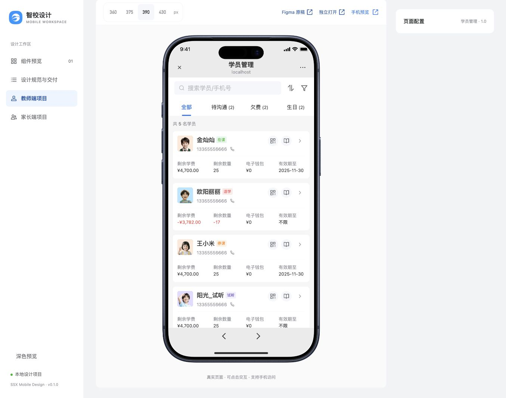
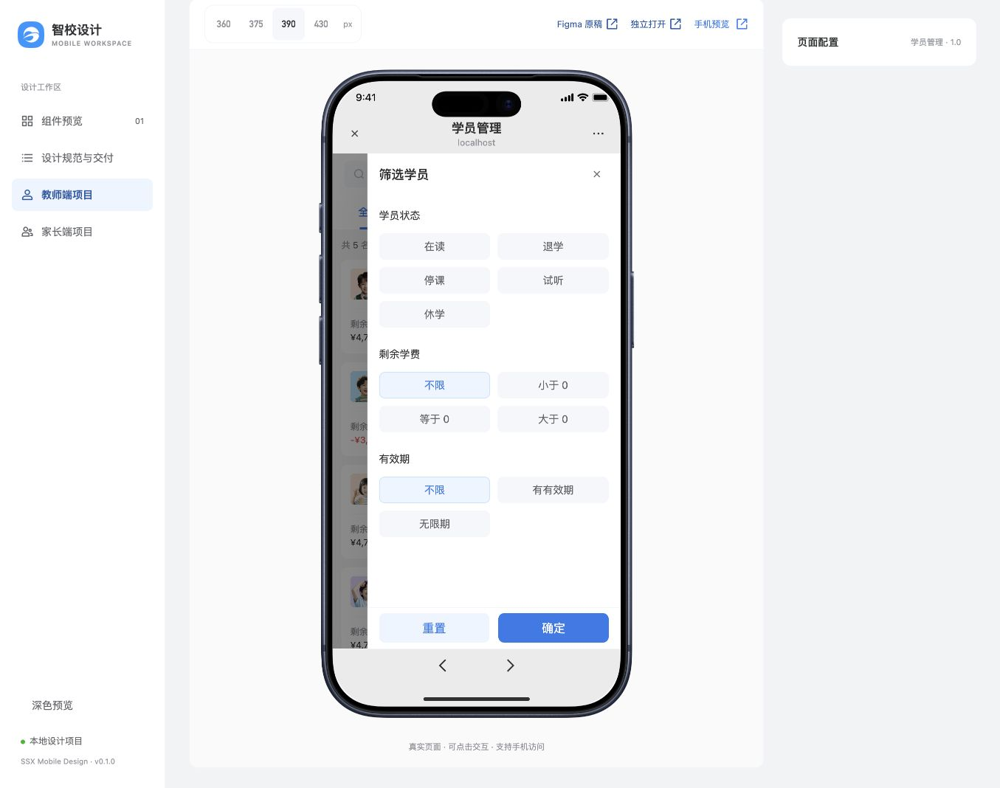
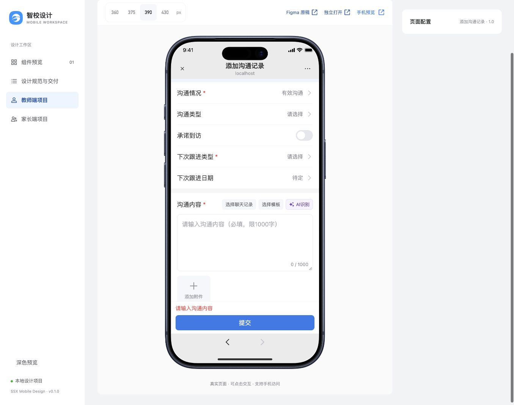
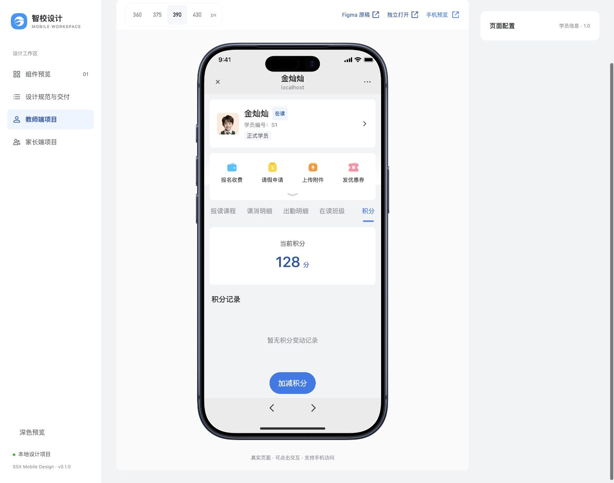
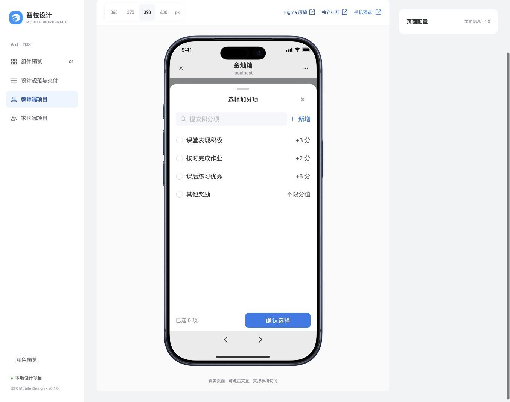
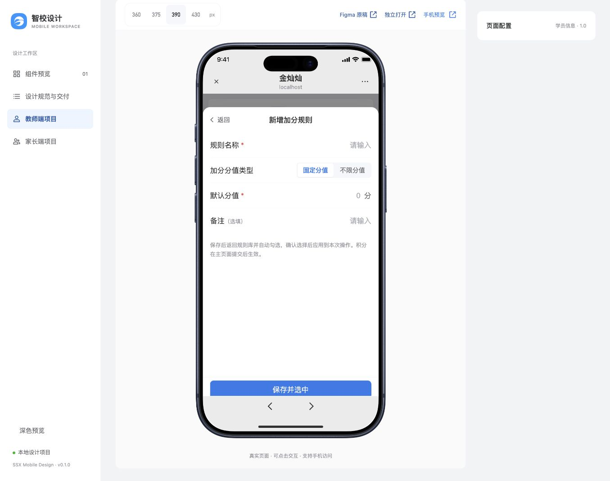
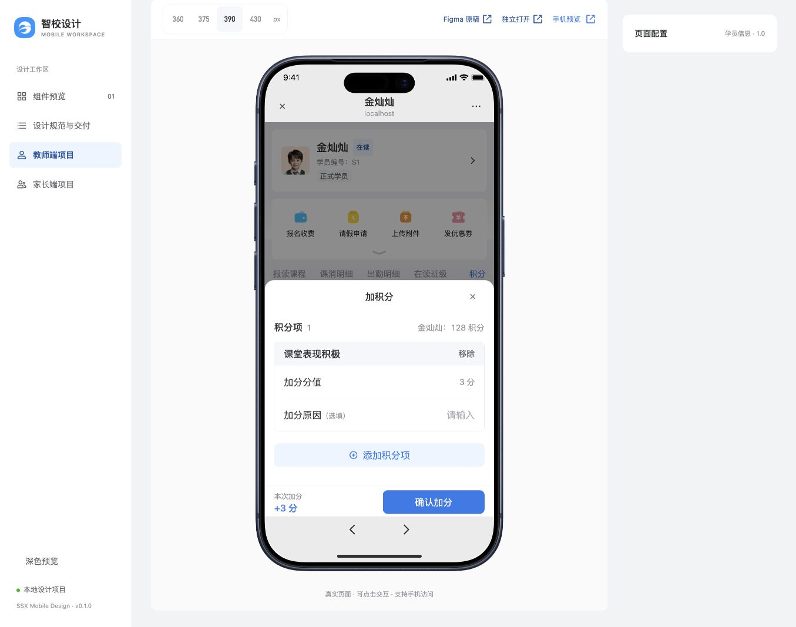
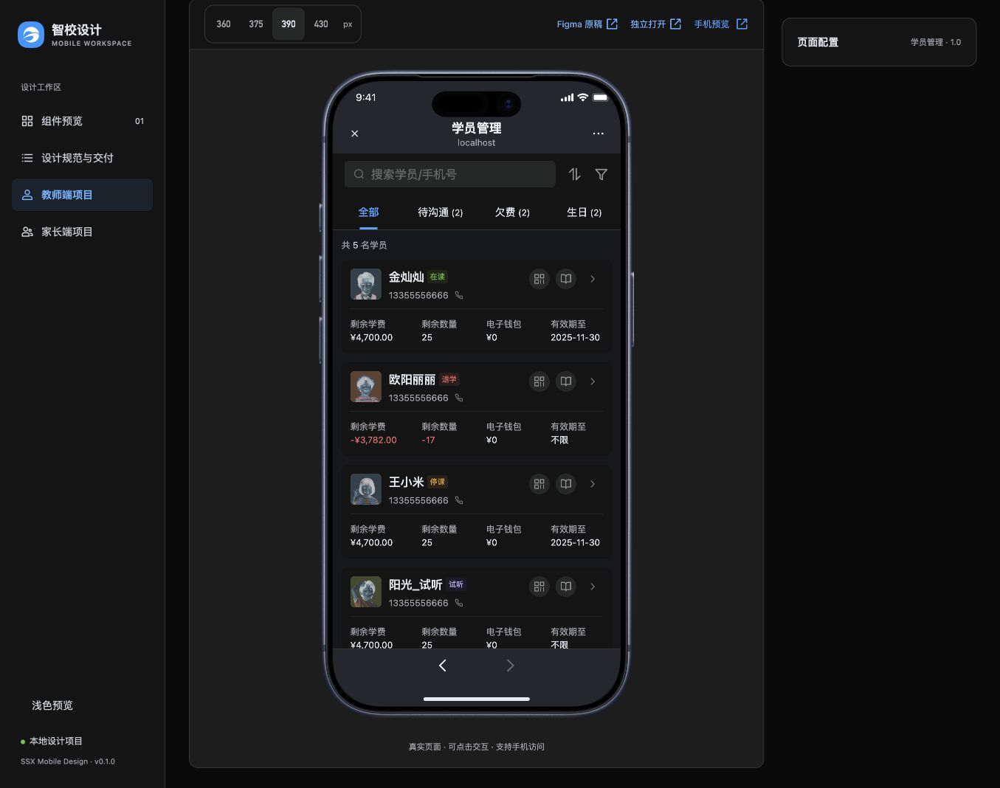
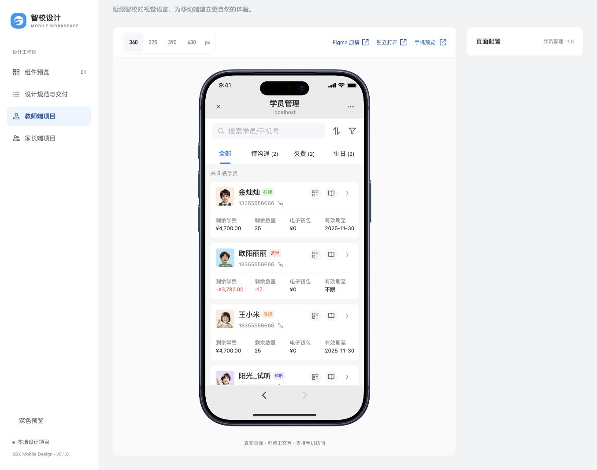
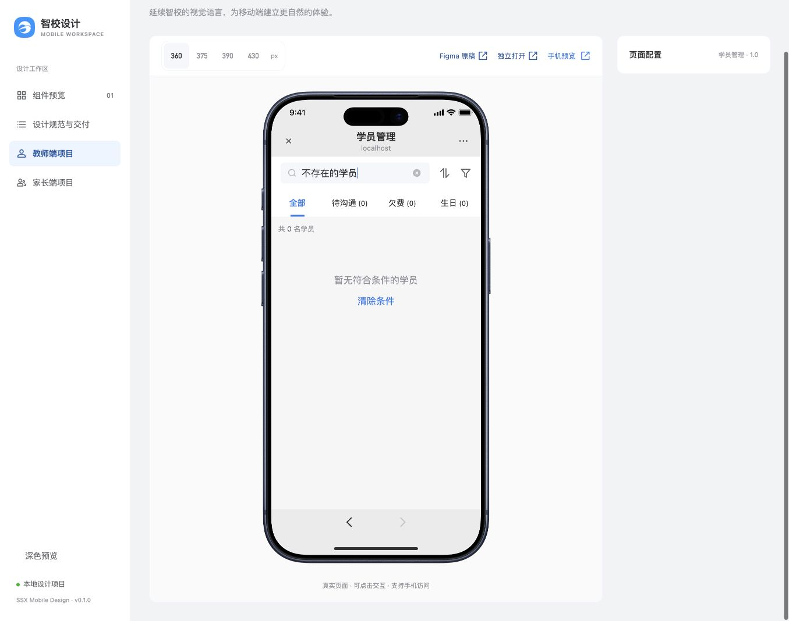

# 学员管理模块规范审查 · 2026-11-02

结论：核心页面结构与近期确认的场景规则基本统一，但不能声称完全符合。发现六项 P2（建议整改）及一项 P3（暗色局部问题）。本次仅生成 D 类审查记录，未修改页面业务源码、未提交、推送或部署。

## 范围与依据

证据为本次运行中新采集的12张浏览器截图、DOM/计算样式及当前源码。检查列表、筛选、详情、沟通表单、积分分类与选择/新增/编辑弹层、空搜索、试听身份；依据 DESIGN.md、list-pages.md、page-patterns.md、components.md、typography.md、accessibility.md、sheet-interactions.md 及相关需求。

已读取学员与意向客户两个列表实现，保留四列财务与三列跟进信息等业务差异。浅色检查390px主视图及360px列表/试听详情，暗色仅390px列表轻量抽查。没有使用此前测试截图代替本次审查证据。

未执行收费、转校、有效提交沟通、保存规则或积分变更；中间积分草稿已放弃。

## 已确认规则及例外

- 共同规则：本地组件与语义色、头像6px圆角、独立操作40px热区、56/48/40px顶部层级、筛选草稿边界、错误定位及焦点恢复。
- 业务差异：学员四列财务/有效期、意向客户三列跟进；列表滚动与详情功能区不能强制套用完全相同组合。
- 用户近期明确确认：功能图标24px；收起图标24×8px、区域24px高且不外扩；功能网格底部无额外8px内边距；积分详情按钮48px/底栏64px；沟通正文16px/25px。这些均不记为违规。
- 标准积分弹层底栏仍56px，详情页64px是局部例外。
- 品牌蓝按钮与白字已有约4.25:1的批准例外，不列为新问题。下文S06测量的是普通辅助文字的另一组前景/背景。

## 发现清单

### S01 · P2 · 试听身份被固定标为正式学员（已移除）

步骤12中，阳光_试听（s4）同时出现“试听”状态和“正式学员”标签，身份信息矛盾。正式详情分支将身份标签写成固定文本。

源码：[CustomerInfoPage.tsx](../../../src/pages/ai-communication/v1/CustomerInfoPage.tsx)，第73行。

2026-11-02 用户明确要求先移除用途未明确的下方“正式学员”标签；已移除，保留实际状态标签。原审查截图仅记录整改前现状。

### S02 · P2 · 分值类型控件点击区不足

步骤7实测“固定分值”和“不限分值”按钮高度30px，伪元素高度为auto、无40px热区扩展，低于项目点击区下限。此项不属于已确认的24px功能区收起条例外。

源码：[points-adjustment.css](../../../src/pages/student-info/v1/points-adjustment.css)，第68行。

建议：复用已有选择组件或将该局部组合的命中区域做到40px，同时防止相邻热区重叠。

### S03 · P2 · 列表快捷操作热区重叠

步骤1实测二维码与课程两个视觉按钮宽28px、间距8px，中心相距36px；各自扩展为40px热区，因此水平方向重叠4px。存在边界误触风险，本次没有将其描述为已经复现的错误跳转。

源码：[students.css](../../../src/pages/students/v1/students.css)，第27行；热区扩展见src/styles/global.css。

建议：保留图标视觉尺寸，为快捷操作安排互不重叠的40px命中区域，同时保持身份区详情点击。

### S04 · P2 · 必填标识与提交校验不一致

步骤4的“下次跟进类型”在视觉及读屏名称中均标为必填，但submit检查内容、结果、日期等时，没有nextMode非空校验。Cell的required只绘制标识，不自动执行提交校验。

证据为表单截图及源码核对；未有效提交，以免写入本地记录。

源码：[CommunicationForm.tsx](../../../src/pages/ai-communication/v1/CommunicationForm.tsx)，第44—49及74行。

建议：先确定该字段是否业务必填，再统一星号、读屏说明和提交校验。不能在视觉整改时自行增加必填业务。

### S05 · P2 · 空提交后没有定位首个错误字段

步骤4空提交后出现“请输入沟通内容”，但document.activeElement仍为BUTTON“提交”，没有聚焦正文输入框。与sheet-interactions.md中已确认的首错定位规则不一致。

源码：[CommunicationForm.tsx](../../../src/pages/ai-communication/v1/CommunicationForm.tsx)，第46行。

建议：保留错误和输入内容，聚焦并滚动到首个错误字段。

### S06 · P2 · 普通辅助文字对比度低于项目目标

步骤1中，“剩余学费”等12px常规标签的计算前景色为rgb(144,147,153)，即#909399；卡片背景色为rgb(255,255,255)，即#FFFFFF。按相对亮度计算，对比度为3.079:1，低于项目普通文字4.5:1目标。

源码：[students.css](../../../src/pages/students/v1/students.css)，第34行。此项不属于已批准的品牌主按钮颜色例外。

建议：先展示并确认这组前景/背景的调整方案，不为通过检查擅自更换品牌或文字颜色角色。本次未改色。

### S07 · P3 · 暗色滤镜误伤照片头像

步骤9实测照片头像filter为invert(0.8)，截图可见照片反色。原因是暗色选择器覆盖student-page中的全部img。

源码：[students.css](../../../src/pages/students/v1/students.css)，第43行。

建议：只适配需要变色的单色旧图标，照片和彩色资产保留原色。当前目标为浅色，因此此项列为暗色局部问题。

## 流程检查结果

| 步骤 | 页面/状态 | 状况与观察 |
| --- | --- | --- |
| 1 | 学员列表 | 基本符合；存在快捷热区重叠、辅助文字对比度问题。48px Tab、40px数量栏、12px卡片间距与6px头像圆角符合已确认结构。 |
| 2 | 筛选抽屉 | 本次所见符合；36px筛选项具40px热区，关闭/重置/确定清楚。未应用筛选。 |
| 3 | 正式学员详情 | 近期确认的11Tab、功能区、16px沟通正文和48px底部入口符合；办理动作和其他业务Tab仍属原型占位。 |
| 4 | 沟通表单空提交 | 需整改；必填标识与校验不一致、空提交未聚焦首错。 |
| 5 | 积分分类 | 本次所见符合；48px按钮属于批准的局部例外，128分是本页模拟余额。 |
| 6 | 加分项选择 | 本次所见符合；有横杠、关闭、多选标记及数量确认底栏。未提交积分。 |
| 7 | 新增积分规则 | 需整改；编辑头/返回结构基本符合，分值类型按钮只有30px。 |
| 8 | 积分主编辑 | 本次所见基本符合；editor无横杠，合计与确认底栏实测56px，退出有草稿保护。 |
| 9 | 暗色列表 | 需整改；人物照片被反色。 |
| 10 | 360px列表 | 本次样例无水平溢出；document宽360px，列表clientWidth/scrollWidth均360px。 |
| 11 | 空搜索 | 本次所见符合；0名、空态、清除条件可恢复。 |
| 12 | 试听详情 | 已移除固定“正式学员”标签，保留试听状态；原截图为整改前证据。 |

## 验证与边界

- 当前代码基线运行pnpm check与pnpm build，均通过；本次未改业务源码、未新增测试或重复全量E2E。
- 九个业务Tab空态、顶部办理动作提示、积分清零待设计、积分本页内存及AI本地模拟是已记录的原型边界，不与规范违规混列。
- 本轮未实际操作排序方向、真实下拉刷新、真实录音/转写、附件上传、生产权限和后端持久化。
- 未做375/430px全流程、长文本/长金额压力检查、屏幕阅读器、真机键盘/触摸/微信WebView验收，不宣称全设备或完整可访问性通过。
- 已登记的积分dirty基线比较、保存新增规则后的搜索上下文等待迁移问题，本轮未完整复现，保留原状态，不声称新发现或已解决。
- 建议先处理身份标签、30px点击区、快捷热区重叠、错误定位。必填先明确业务规则，文字颜色先确认前景/背景调整，暗色照片滤镜最后局部修复。不将这些建议自动升级为公共组件或全局规范。

## 本次截图证据

### 01-list

### 02-filter

### 03-detail

### 04-communication-form

### 05-points

### 06-points-selection

### 07-rule-editor

### 08-points-editor

### 09-dark-list

### 10-list-360

### 11-empty-search

### 12-trial-identity

## 字体变量补充与后续迁移

2026-11-02 用户追问后补充核查：页面颜色采用语义变量，但字体仍有直接数值声明。用户随后授权保持视觉不变进行变量收敛。现已将上述四个页面样式文件中95处字号、23处字重改为已有变量，并静态核对解析值一致；4处10px因没有对应变量保留。行高、间距、颜色和原有7项审查问题未顺带修改。详见design-system/typography.md迁移记录。本段为后续迁移结果，不改变前文原审查截图和发现。
