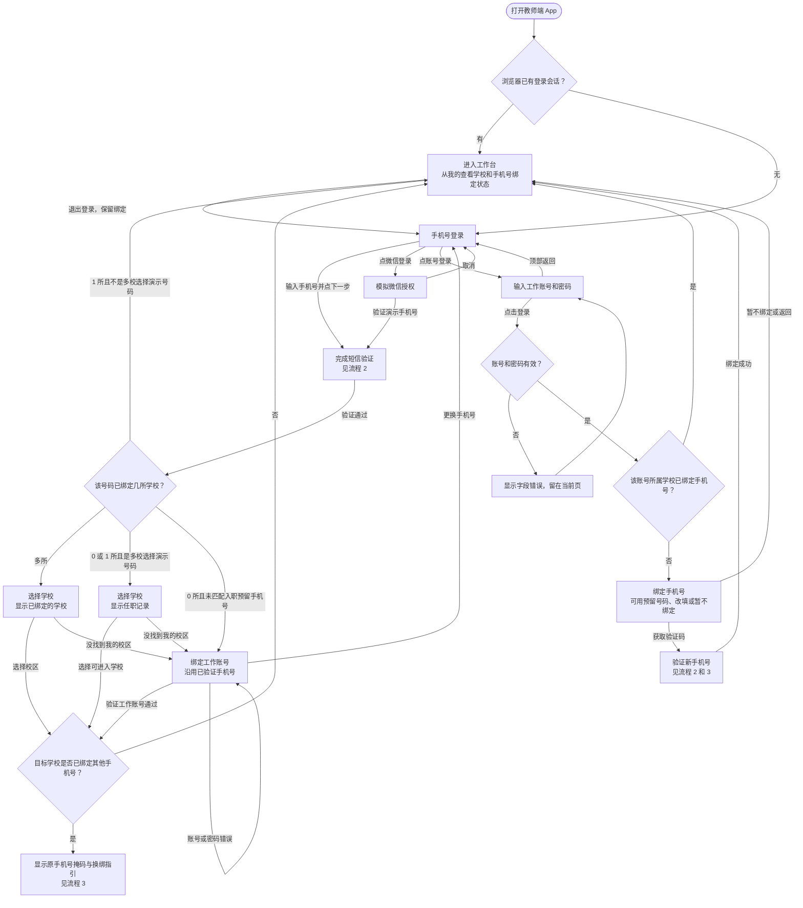
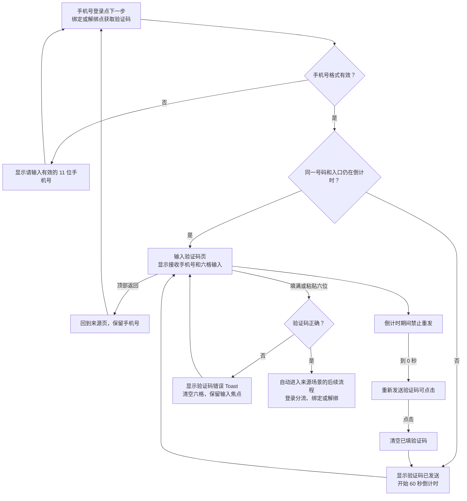
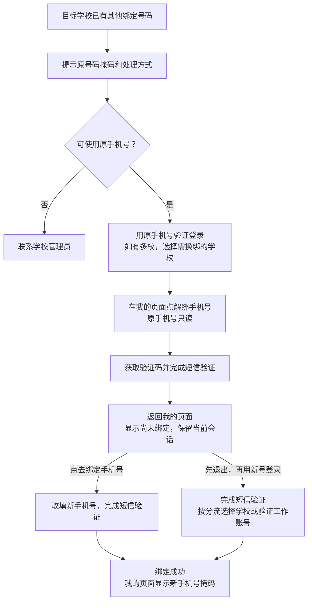

# 教师端 App 登录交互与测试流程

测试范围为当前 v1 原型。验证码、账号与学校数据均为模拟数据，登录会话和绑定关系保存在当前浏览器。登录成功后进入「工作台」，可从底部「我的」查看绑定状态和退出登录。

[打开教师端 App 原型](http://localhost:5178/#/pages/teacher-app/v1?theme=light&chrome=app)

## 1. 登录入口

「选择学校」页的已离职记录不可点击。在选校页点「没找到我的校区」进入绑账号页，顶部返回回到选校页。从未匹配预留号码直接进入绑账号页时，顶部返回回到手机号登录。

## 2. 短信验证

手机号登录、绑定与解绑都使用同一个「输入验证码」页。

输入不足六位时停在本页。点已有数字的格子后仍从末尾续输，退格从末尾删。验证页填满六位就校验。

## 3. 绑定、解绑与冲突处理

普通号码绑定一所学校后直登，绑定多所时需要选校。多校选择演示号码即使仅绑定一所学校，退出后复登也会进入选校。解绑只移除当前学校的绑定。刷新同一地址会恢复已保存的学校会话。账号校验成功时原型已保存会话，因此在首次「绑定手机号」页刷新也会进入「工作台」，在「我的」中可看到尚未绑定。

## 测试数据与验收清单

| 演示数据 | 值 |
| --- | --- |
| 初始已绑定的工作账号 | `teacher@example.com`，星禾艺术学校，已绑定 `13700137000` |
| 初始未绑定的工作账号 | `new@example.com`，青禾美术学校，可绑定或跳过 |
| 两个工作账号的密码 | `888888` |
| 所有演示号码的短信验证码 | `123456` |
| 入职预留手机号与多校选择演示号码 | `13700137000` |
| 首次绑定手机号 | `13800138000` |
| 用于触发已有绑定冲突的新手机号 | `13900139000` |

涉及默认绑定或初始未绑定的用例，从无历史站点数据的浏览器环境开始。只点击「退出登录」会保留已有绑定，适合验证复登。

| 编号 | 操作 | 预期 |
| --- | --- | --- |
| 01 | 首次打开，输入空值或不合法手机号后点「下一步」 | 默认进入手机号登录，显示字段错误，留在当前页 |
| 02 | 用预留号码获取验证码，先填 5 位，点第一格后退格，再填错 6 位 | 5 位时不跳转，退格删末位，错误 Toast 出现且六格清空 |
| 03 | 发码后立即尝试重发，到 60 秒再点重发 | 倒计时禁点，到期可点，重发清空已填数字、出现成功 Toast 并重新倒计时 |
| 04 | 发码后返回，再用同一号码点「下一步」 | 号码保留，仍在原倒计时。改用其他号码则重新发码 |
| 05 | 预留号码填正确验证码，选择可进入校区 | 自动进入选校，已离职记录不可点。选中后显示目标学校与号码掩码 |
| 06 | 选校时点「没找到我的校区」，使用初始未绑定账号 | 打开绑账号页。绑定成功后进入青禾美术学校 |
| 07 | 用首次绑定号码验证，再填工作账号和密码 | 进入绑账号页。空字段、错误凭证留在原页。正确凭证完成绑定 |
| 08 | 从首页切换账号登录，提交正确凭证 | 已绑定直接登录。未绑定时预填预留号码，可改填、绑定或暂不绑定 |
| 09 | 先用 138 号绑定青禾并退出，再用 139 号验证并尝试绑定同一账号 | 提示原号码 `138****8000`。改用原号登录、验证解绑，再用 139 号绑账号后显示 `139****9000` |
| 10 | 用预留号码验证并选云谷，退出后用同号复登 | 展开星禾与云谷两所已绑定学校，点哪个校区就进入哪个校区 |
| 11 | 登录成功后刷新或重新打开同一地址，再退出后刷新 | 登录后恢复当前学校。退出后恢复登录首页，原绑定关系仍可用于复登 |
| 12 | 点击「微信登录」，分别取消和继续验证 | 取消回到首页，继续进入演示手机号的验证码页，验证码正确后按手机号流程分流 |

现有自动化用例见 [teacher-login.spec.ts](../../tests/teacher-login.spec.ts)。原型需求见 [教师端 App](teacher-app.md)。
